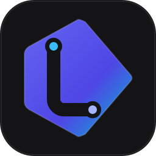

<p align="center">
  
</p>

# Lincast Chat

Voice, video and text chat for groups of friends, with a self-hostable server and a native Linux client.
Direct messages and groups, calls that ring, profiles with game lists, and **screen sharing with per-application (or whole-PC) audio on Wayland**.

## Features

- **Conversations:** direct messages and unlimited groups, with replies, reactions, pins, edits, forwarding, favorites, GIF/emoji picker and file attachments up to 200 MB.
- **Calls:** one-click calls with a 30 s ring (the caller hears the ringback too), mute/deafen, push-to-talk, per-person volume, camera and soundboard.
- **Screen sharing:** the screen/window choice is remembered through the ScreenCast portal; pick which apps' audio goes along (or the whole PC, never the call itself). Click a stream to focus it, right-click for volume.
- **Profiles:** avatar and banner (images or GIFs), custom status, activity (game with cover art, music with progress), game lists backed by SteamGridDB, wall posts for friends.
- **Extras:** daily Wordle, whiteboard, wheel, polls.
- **Desktop:** tray icon, notifications, themes (including Wallust), reduced-motion and GIF-on-hover options, update banner.

## Repository layout

| Path | What |
|---|---|
| `server.js`, `wordle-words.txt` | Server (Node.js, only dependency: `ws`). |
| `v2/cliente` | Native client (Rust, [iced](https://iced.rs), `libwebrtc`). |
| `v2/concord-audio` | Helper process: PipeWire per-app audio and screen video from the portal. It must stay a separate binary (it cannot link `libwebrtc`). |
| `public/` | Minimal landing page served by the server. |
| `scripts/` | Smoke tests, deploy and install scripts. |
| `packaging/` | Arch (PKGBUILD) and AppImage recipes. |

## Install the client (Linux x86_64)

One line (downloads the latest release, verifies its SHA-256 and installs to `~/.local`):

```bash
curl -fsSL https://raw.githubusercontent.com/LinCastr/lincast-chat/main/install.sh | bash
```

Prefer to read the script first? It is [`install.sh`](install.sh). Packages are also on the [releases page](https://github.com/LinCastr/lincast-chat-releases/releases): extract `lincast-chat-<version>-linux-x86_64.tar.gz` and run `./install.sh --user`.

Requirements: PipeWire, `xdg-desktop-portal` with a ScreenCast backend (e.g. `xdg-desktop-portal-hyprland`), `wpctl` for system volume.
The app checks for a new release every time it opens and **updates itself** (it downloads the tarball, verifies the SHA-256 published with the release, swaps the binaries and restarts). *Settings → Sistema → Verificar atualização* does the same on demand. Installs in a read-only location (e.g. a distro package) cannot self-update; use your package manager.

## Build from source

Prerequisites: Rust, `pipewire` and `libpipewire` headers, `openssl`, `clang`.

```bash
make            # release build
make check      # desktop file validation + clippy
make test       # unit tests
./scripts/install-desktop.sh --user
```

## Run a server

```bash
npm install ws
PORT=8090 node server.js
```

State lives in `chatdata/` and a few dot files next to `server.js`; **never delete them**. Optional integration files (all git-ignored): `.giphy.json` (GIF search), `.steamgriddb.json` (game covers), `.discord-oauth.json` / `.discord-bot.json` (Discord login and bot). Put it behind a TLS reverse proxy (nginx) and set `client_max_body_size 200m`.

Server checks (run against a disposable copy):

```bash
WORDLE_PALAVRA=crane TOQUE_MS=1500 AVISOS_GRACA_MS=300 PORT=8099 node server.js &
node scripts/conversas-smoke-test.js http://localhost:8099
node scripts/arquivos-smoke-test.js http://localhost:8099
```

## License

[GNU General Public License v3.0](LICENSE). Third-party components keep their own licenses (see Credits).

## Credits

- `wordle-words.txt` is the five-letter word list from Donald Knuth's Stanford GraphBase.
- The Figtree font is under the SIL Open Font License (`v2/cliente/assets/fonts/Figtree-OFL.txt`).
- Icons are from [Lucide](https://lucide.dev) (ISC License).
